# Mapa de historias

Generado por `NarradorCoop/herramientas/mapa_historias.py` a partir de los arcos. No editar a mano:
se vuelve a generar con `python3 NarradorCoop/herramientas/mapa_historias.py` (necesita `pip install lupa`).
Los lanzadores del servidor estan en la lista `LANZADORES` del script; si se agrega uno, se agrega ahi.
Las memorias y lo que guardan estan en `NarradorCoop/herramientas/memorias.py`.

## Diagrama

Cada flecha sale del final que la provoca y dice que memoria deja. Los nodos redondeados son desenlaces:
decisiones que cierran una linea en vez de abrir otra historia. Las flechas con `x` cortan una historia:
despues de esa memoria ya no sale.

```mermaid
flowchart LR
  asalto_nocturno["Asalto al refugio"]
  bandido_1["El camino del bandido: el traidor"]
  bandido_2["El camino del bandido: la comisaria"]
  bandido_3["El camino del bandido: la familia"]
  bandido_4["El camino del bandido: las latas"]
  bandido_5["El camino del bandido: la decision"]
  bandido_castigo["Bandido: el jefe descubre el sabotaje"]
  bandido_maulen["El camino del bandido: Maulen"]
  cal_amigo_secreto["El amigo secreto de Sous"]
  cal_fonda["La fonda de Sous"]
  cap_cabo_2["La puerta de atras"]
  cap_chela_2["La radio del cuartel"]
  cap_nacho_2["El ring de Lexington"]
  cap_nacho_3["La muchacha que esperaba"]
  cap_rosa_2["La ruta 31"]
  cap_rosa_3["El estanque"]
  conquista_muldraugh["La conquista: la comisaria del Cabo Ramiro"]
  conquista_riverside["La conquista: la iglesia del Padre Nacho"]
  conquista_rosewood["La conquista: la bencinera de la Misia Rosa"]
  conquista_sous["La conquista: la base de Sous"]
  conquista_westpoint["La conquista: el cuartel de la Tia Chela"]
  desbloqueo_muldraugh["Cabo Ramiro quiere un campamento"]
  desbloqueo_riverside["Padre Nacho quiere un campamento"]
  desbloqueo_rosewood["Misia Rosa quiere un campamento"]
  desbloqueo_westpoint["Tia Chela quiere un campamento"]
  eduardo_atentado["Eduardo viene por ti"]
  eduardo_evento["Eduardo, corriendo"]
  eduardo_fallas["Fallas Lake"]
  eduardo_vuelve["Eduardo, otra vez"]
  familia_infectada["Los Bell"]
  favor_bastian["Favor de Tati"]
  favor_benjamin["Favor de Matric"]
  favor_cristian["Favor de Cristonks"]
  favor_cristobal["Favor de Wertres"]
  favor_david["Favor de Shinbo"]
  favor_hanz["Favor de Walita"]
  favor_jorge["Favor de Hasag"]
  favor_martin_a["Favor de Akagami"]
  favor_martin_z["Favor de Zent"]
  hija_cabo["Valentina"]
  leyenda_eduardo["Un cientifico que dice tener la cura"]
  reconquista_muldraugh["La reconquista: la comisaria de Muldraugh"]
  reconquista_patio["La reconquista: el patio de trenes"]
  reconquista_riverside["La reconquista: la iglesia de Riverside"]
  reconquista_rosewood["La reconquista: la bencinera de Rosewood"]
  reconquista_westpoint["La reconquista: el cuartel de West Point"]
  sous["Sous"]
  sous_arsenal["El arsenal"]
  sous_guerra["La guerra con Sous"]
  trueque_trampa["El trueque"]
  fin_bandido_pereira_escapo(["El jefe del patio escapa"])
  fin_bandido_rechazado(["Rechaza a la banda (la puerta queda abierta)"])
  fin_bandido_redimido(["Redencion: Knox vuelve a 0"])
  fin_estanque_rosewood_defendido(["El estanque queda a salvo"])
  fin_fin_eduardo_muerto(["FIN: Eduardo muerto, Knox es de la banda"])
  fin_fin_reconquista(["FIN: Knox vuelve a ser luz de esperanza"])
  fin_hija_cabo_muerta(["Valentina muere"])
  fin_hija_cabo_salvada(["Valentina vuelve con el Cabo"])
  fin_lucia_en_riverside(["Lucia vuelve a Riverside"])
  fin_sous_caidos(["Sous cae en su base"])
  fin_sous_conquistada(["La base de Sous es de Maulen"])
  fin_sous_eliminado(["Sous eliminado"])
  fin_sous_maulen_escapa(["Maulen escapa con todo"])
  fin_sous_negado(["Le dices que no a Sous"])
  bandido_1 -->|final_cumplido, final_perdonado: bandido_cap = 1| bandido_2
  bandido_2 -->|final_cumplido, final_saboteado: bandido_cap = 2| bandido_3
  bandido_2 -->|final_saboteado: bandido_sospecha| bandido_castigo
  bandido_3 -->|final_cumplido, final_saboteado: bandido_cap = 3| bandido_4
  bandido_3 -->|final_saboteado: bandido_sospecha| bandido_castigo
  bandido_4 -->|final_cumplido, final_saboteado: bandido_cap = 4| bandido_5
  bandido_4 -->|final_saboteado: bandido_sospecha| bandido_castigo
  bandido_5 -->|final_con_pereira: bandido = pereira| conquista_muldraugh
  bandido_5 -->|final_con_pereira: bandido = pereira| conquista_sous
  cap_cabo_2 -->|final_cumplido, final_muerta: historia_muldraugh_2| hija_cabo
  cap_chela_2 -->|final_cumplido: historia_westpoint_2| leyenda_eduardo
  cap_nacho_2 -->|final_cumplido: historia_riverside_2| cap_nacho_3
  cap_rosa_2 -->|final_cumplido, final_muerto: historia_rosewood_2| cap_rosa_3
  conquista_muldraugh -->|final_conquistado: conquista_muldraugh| conquista_riverside
  conquista_muldraugh -->|final_conquistado: conquista_muldraugh| conquista_rosewood
  conquista_muldraugh -->|final_conquistado: conquista_muldraugh| conquista_westpoint
  conquista_muldraugh -->|knox_conquistado| eduardo_atentado
  conquista_riverside -->|knox_conquistado| eduardo_atentado
  conquista_rosewood -->|knox_conquistado| eduardo_atentado
  conquista_westpoint -->|knox_conquistado| eduardo_atentado
  desbloqueo_muldraugh -->|final_campamento: historia_muldraugh_1| bandido_2
  desbloqueo_muldraugh -->|final_campamento: historia_muldraugh_1| cap_cabo_2
  desbloqueo_riverside -->|final_campamento: historia_riverside_1| cap_nacho_2
  desbloqueo_rosewood -->|final_campamento: historia_rosewood_1| cap_rosa_2
  desbloqueo_westpoint -->|final_campamento: historia_westpoint_1| cap_chela_2
  desbloqueo_westpoint -->|final_campamento: historia_westpoint_1| eduardo_vuelve
  eduardo_atentado -->|nota: eduardo_nota = true| eduardo_fallas
  eduardo_evento -->|caido_eduardo| eduardo_vuelve
  eduardo_fallas -->|final_reconquista: reconquista = true| reconquista_muldraugh
  eduardo_fallas -->|final_reconquista: reconquista = true| reconquista_riverside
  eduardo_fallas -->|final_reconquista: reconquista = true| reconquista_rosewood
  eduardo_fallas -->|final_reconquista: reconquista = true| reconquista_westpoint
  familia_infectada -->|final_abandonados: abre| sous
  familia_infectada -->|final_engano: abre| sous
  familia_infectada -->|final_era_gripe: abre| sous
  familia_infectada -->|final_falso_remedio: abre| sous
  familia_infectada -->|final_masacre: abre| sous
  familia_infectada -->|final_muertos: abre| sous
  familia_infectada -->|final_olvidados: abre| sous
  familia_infectada -->|final_salvados: abre| sous
  familia_infectada -->|final_se_curo_solo: abre| sous
  familia_infectada -->|final_transformado: abre| sous
  leyenda_eduardo -->|caido, despedida: eduardo_conocido| eduardo_evento
  leyenda_eduardo -->|caido_eduardo| eduardo_vuelve
  reconquista_muldraugh -->|final_reconquistado: reconquista_muldraugh| reconquista_patio
  reconquista_riverside -->|final_reconquistado: reconquista_riverside| reconquista_patio
  reconquista_rosewood -->|final_reconquistado: reconquista_rosewood| reconquista_patio
  reconquista_westpoint -->|final_reconquistado: reconquista_westpoint| reconquista_patio
  sous -->|perdonado: maulen_salvado| bandido_maulen
  sous -->|final_aliados, final_mentira: sous = aliados| cal_amigo_secreto
  sous -->|final_aliados, final_mentira: sous = aliados| cal_fonda
  sous -->|final_aliados, final_mentira: sous = aliados| conquista_sous
  sous -->|perdonado: maulen_salvado| conquista_sous
  sous -->|final_aliados, final_mentira: sous = aliados| favor_bastian
  sous -->|final_aliados, final_mentira: sous = aliados| favor_benjamin
  sous -->|final_aliados, final_mentira: sous = aliados| favor_cristian
  sous -->|final_aliados, final_mentira: sous = aliados| favor_cristobal
  sous -->|final_aliados, final_mentira: sous = aliados| favor_david
  sous -->|final_aliados, final_mentira: sous = aliados| favor_hanz
  sous -->|final_aliados, final_mentira: sous = aliados| favor_jorge
  sous -->|final_aliados, final_mentira: sous = aliados| favor_martin_a
  sous -->|final_aliados, final_mentira: sous = aliados| favor_martin_z
  sous -->|final_aliados: abre| sous_arsenal
  sous -->|final_mentira: abre| sous_arsenal
  sous -->|final_te_quedaste: abre| sous_guerra
  sous -->|final_traicion: abre| sous_guerra
  sous_guerra -->|final_sous_eliminado: abre| sous_arsenal
  trueque_trampa -->|final_escapaste: eco| asalto_nocturno
  bandido_5 --x|corta: final_con_pereira: bandido = pereira| eduardo_evento
  eduardo_fallas --x|corta: final_eduardo_muerto: fin| eduardo_atentado
  eduardo_fallas --x|corta: final_eduardo_muerto: eduardo_muerto_duelo| eduardo_evento
  eduardo_fallas --x|corta: final_eduardo_muerto: fin| eduardo_evento
  eduardo_fallas --x|corta: final_eduardo_muerto: fin| reconquista_muldraugh
  eduardo_fallas --x|corta: final_eduardo_muerto: fin| reconquista_patio
  eduardo_fallas --x|corta: final_eduardo_muerto: fin| reconquista_riverside
  eduardo_fallas --x|corta: final_eduardo_muerto: fin| reconquista_rosewood
  eduardo_fallas --x|corta: final_eduardo_muerto: fin| reconquista_westpoint
  reconquista_patio --x|corta: final_luz: fin| eduardo_atentado
  reconquista_patio --x|corta: final_luz: fin| eduardo_evento
  reconquista_patio --x|corta: final_luz: fin| eduardo_fallas
  reconquista_patio --x|corta: final_luz: fin| reconquista_muldraugh
  reconquista_patio --x|corta: final_luz: fin| reconquista_riverside
  reconquista_patio --x|corta: final_luz: fin| reconquista_rosewood
  reconquista_patio --x|corta: final_luz: fin| reconquista_westpoint
  bandido_1 -.->|final_rechazo| fin_bandido_rechazado
  bandido_5 -.->|final_escapo| fin_bandido_pereira_escapo
  bandido_5 -.->|final_redencion| fin_bandido_redimido
  bandido_maulen -.->|final_rechazo| fin_bandido_rechazado
  cap_nacho_3 -.->|final_cumplido| fin_lucia_en_riverside
  cap_rosa_3 -.->|final_cumplido| fin_estanque_rosewood_defendido
  conquista_sous -.->|final_conquistado| fin_sous_conquistada
  eduardo_fallas -.->|final_eduardo_muerto| fin_fin_eduardo_muerto
  hija_cabo -.->|final_perdida| fin_hija_cabo_muerta
  hija_cabo -.->|final_reencuentro| fin_hija_cabo_salvada
  reconquista_patio -.->|final_luz| fin_fin_reconquista
  sous -.->|final_sous_caidos| fin_sous_caidos
  sous -.->|final_maulen_escapa| fin_sous_maulen_escapa
  sous -.->|final_negado| fin_sous_negado
  sous_guerra -.->|final_sous_eliminado| fin_sous_eliminado
```

## Decisiones

Las historias con mas de un final. Cada camino dice la ultima eleccion antes del final (si hubo que elegir)
y la condicion que lo decide (lo sorteado al empezar, quien murio, el tiempo...). Un renglon por camino.

### El alijo (`alijo_custodiado`)

| Final | Como se llega | Deja | Lleva a |
| --- | --- | --- | --- |
| `final_encontrado` | `pasan 2 h` | `alijo` = encontrado | - |
| `final_perdido` | `pasan 72 h` `pasan 96 h` | - | - |

### Asalto al refugio (`asalto_nocturno`)

| Final | Como se llega | Deja | Lleva a |
| --- | --- | --- | --- |
| `final_rechazado` | `todos_muertos asaltantes` | `asalto` = rechazado | - |
| `final_se_retiraron` | `pasan 12 h` | - | - |

### El camino del bandido: el traidor (`bandido_1`)

| Final | Como se llega | Deja | Lleva a |
| --- | --- | --- | --- |
| `final_abandonado` | "Que necesitas?", y despues `reloj_vencido plazo` `pasan 24 h` `pasan 72 h` | `bandido_ultimo` = abandonado | - |
| `final_cumplido` | "Dejarlo ir. Pedirle su placa como prueba", y despues `nil` | `bandido_cap` = 1, `bandido_ultimo` = hecho | bandido_2 |
| `final_perdonado` | "Dejarlo ir. Pedirle su placa como prueba", y despues `perdonado = true` | `bandido_cap` = 1, `bandido_ultimo` = hecho | bandido_2 |
| `final_rechazo` | "No trabajo para nadie" | `bandido` = rechazado | Rechaza a la banda (la puerta queda abierta) |

### El camino del bandido: la comisaria (`bandido_2`)

| Final | Como se llega | Deja | Lleva a |
| --- | --- | --- | --- |
| `final_abandonado` | "Voy esta noche", y despues `reloj_vencido plazo` `pasan 24 h` `pasan 6 h` | `bandido_ultimo` = abandonado | - |
| `final_cumplido` | "Avisarle al Cabo lo que quiere {jefe_corto}", y despues `nil` | `bandido_cap` = 2, `bandido_ultimo` = hecho | bandido_3 |
| `final_saboteado` | "Avisarle al Cabo lo que quiere {jefe_corto}", y despues `sabotaje = true` | `bandido_cap` = 2, `bandido_sospecha` = ?, `bandido_ultimo` = hecho | bandido_3, bandido_castigo |

### El camino del bandido: la familia (`bandido_3`)

| Final | Como se llega | Deja | Lleva a |
| --- | --- | --- | --- |
| `final_abandonado` | "Entendido", y despues `reloj_vencido plazo` `pasan 24 h` `pasan 6 h` | `bandido_ultimo` = abandonado | - |
| `final_cumplido` | "Decirles que huyan esta noche. Pedirles algo para enganar a {jefe_corto}", y despues `nil` | `bandido_cap` = 3, `bandido_ultimo` = hecho | bandido_4 |
| `final_saboteado` | "Decirles que huyan esta noche. Pedirles algo para enganar a {jefe_corto}", y despues `sabotaje = true` | `bandido_cap` = 3, `bandido_sospecha` = ?, `bandido_ultimo` = hecho | bandido_4, bandido_castigo |

### El camino del bandido: las latas (`bandido_4`)

| Final | Como se llega | Deja | Lleva a |
| --- | --- | --- | --- |
| `final_abandonado` | "Todas", y despues `reloj_vencido plazo` `pasan 24 h` `pasan 6 h` | `bandido_ultimo` = abandonado | - |
| `final_cumplido` | "Llevarte la mitad y decirles que escondan el resto" o "Quitarles todo", y despues `nil` | `bandido_cap` = 4, `bandido_ultimo` = hecho | bandido_5 |
| `final_saboteado` | "Llevarte la mitad y decirles que escondan el resto", y despues `sabotaje = true` | `bandido_cap` = 4, `bandido_sospecha` = ?, `bandido_ultimo` = hecho | bandido_5, bandido_castigo |

### El camino del bandido: la decision (`bandido_5`)

| Final | Como se llega | Deja | Lleva a |
| --- | --- | --- | --- |
| `final_abandonado` | "Irte en silencio. Esto se termina, pero no como ella quiere", y despues `reloj_vencido plazo` `pasan 24 h` `pasan 6 h` | `bandido_ultimo` = abandonado | - |
| `final_con_pereira` | "A tu derecha, {jefe_corto}" | `bandido_cap` = 5, `bandido_ultimo` = hecho, `bandido` = pereira | conquista_muldraugh, conquista_sous |
| `final_escapo` | "Irte en silencio. Esto se termina, pero no como ella quiere", y despues `pasan 12 h` | `bandido_cap` = 5, `bandido_ultimo` = hecho, `bandido` = pereira_escapo | El jefe del patio escapa |
| `final_redencion` | "Irte en silencio. Esto se termina, pero no como ella quiere", y despues `muerto banda pereira` | `bandido_cap` = 5, `bandido_ultimo` = hecho, `bandido` = redimido | Redencion: Knox vuelve a 0 |

### El camino del bandido: Maulen (`bandido_maulen`)

| Final | Como se llega | Deja | Lleva a |
| --- | --- | --- | --- |
| `final_abandonado` | `pasan 24 h` `pasan 72 h` | `bandido_ultimo` = abandonado | - |
| `final_rechazo` | "Te deje vivir. No te debo nada mas" | `bandido` = rechazado | Rechaza a la banda (la puerta queda abierta) |
| `final_unido` | "Que necesitas, Maulen?" | `bandido_ultimo` = hecho | - |

### El amigo secreto de Sous (`cal_amigo_secreto`)

| Final | Como se llega | Deja | Lleva a |
| --- | --- | --- | --- |
| `final_regalo` | "Darle el regalo a {amigo_nombre}" | - | - |
| `final_sin_regalo` | `reloj_vencido plazo` | - | - |

### La fonda de Sous (`cal_fonda`)

| Final | Como se llega | Deja | Lleva a |
| --- | --- | --- | --- |
| `final_fonda` | "Entregar la carne y el carbon para la fonda", y despues `pasan 2.5 h` | `cal.fonda` = hecha | - |
| `final_sin_fonda` | `pasan 30 h` | `cal.fonda` = sin | - |

### La puerta de atras (`cap_cabo_2`)

| Final | Como se llega | Deja | Lleva a |
| --- | --- | --- | --- |
| `final_cumplido` | "Llevarla donde el Cabo", y despues `npc_cerca gladys contacto 15` | `historia_muldraugh_2` = true | hija_cabo |
| `final_muerta` | "Llevarla donde el Cabo", y despues `todos_muertos gladys` `todos_muertos gladys` | `historia_muldraugh_2` = fallido | hija_cabo |

### La muchacha que esperaba (`cap_nacho_3`)

| Final | Como se llega | Deja | Lleva a |
| --- | --- | --- | --- |
| `final_cumplido` | "Decirle que el Padre la espera y que ya no se va", y despues `npc_cerca lucia contacto 15` | `historia_riverside_3` = true, `lucia` = en_riverside | Lucia vuelve a Riverside |
| `final_muerta` | "Decirle que el Padre la espera y que ya no se va", y despues `todos_muertos lucia` `todos_muertos lucia` | `historia_riverside_3` = fallido, `lucia` = muerta | - |

### La ruta 31 (`cap_rosa_2`)

| Final | Como se llega | Deja | Lleva a |
| --- | --- | --- | --- |
| `final_cumplido` | "Entregarle la carga del Gordo Earl" | `historia_rosewood_2` = true | cap_rosa_3 |
| `final_muerto` | `todos_muertos earl` | `historia_rosewood_2` = fallido | cap_rosa_3 |

### La conquista: la comisaria del Cabo Ramiro (`conquista_muldraugh`)

| Final | Como se llega | Deja | Lleva a |
| --- | --- | --- | --- |
| `final_abandonado` | `pasan 12 h` `pasan 96 h` | - | - |
| `final_conquistado` | `misionero_muerto muldraugh` | `conquista_muldraugh` = true | conquista_riverside, conquista_rosewood, conquista_westpoint |

### La conquista: la iglesia del Padre Nacho (`conquista_riverside`)

| Final | Como se llega | Deja | Lleva a |
| --- | --- | --- | --- |
| `final_abandonado` | `pasan 12 h` `pasan 96 h` | - | - |
| `final_conquistado` | `misionero_muerto riverside` | `conquista_riverside` = true | - |

### La conquista: la bencinera de la Misia Rosa (`conquista_rosewood`)

| Final | Como se llega | Deja | Lleva a |
| --- | --- | --- | --- |
| `final_abandonado` | `pasan 12 h` `pasan 96 h` | - | - |
| `final_conquistado` | `misionero_muerto rosewood` | `conquista_rosewood` = true | - |

### La conquista: la base de Sous (`conquista_sous`)

| Final | Como se llega | Deja | Lleva a |
| --- | --- | --- | --- |
| `final_abandonado` | `pasan 12 h` `pasan 96 h` | - | - |
| `final_conquistado` | `todos_muertos sous_base` | `conquista_sous` = true, `sous` = conquistada | La base de Sous es de Maulen |

### La conquista: el cuartel de la Tia Chela (`conquista_westpoint`)

| Final | Como se llega | Deja | Lleva a |
| --- | --- | --- | --- |
| `final_abandonado` | `pasan 12 h` `pasan 96 h` | - | - |
| `final_conquistado` | `misionero_muerto westpoint` | `conquista_westpoint` = true | - |

### Eduardo, corriendo (`eduardo_evento`)

| Final | Como se llega | Deja | Lleva a |
| --- | --- | --- | --- |
| `final_abandonado` | "Esconderte y dejar que el se encargue", y despues `ausente aqui 120 0.2` "Pelear junto a Eduardo", y despues `ausente aqui 120 0.2` `ausente aqui 120 0.15` | - | - |
| `final_cayo` | "Esconderte y dejar que el se encargue", y despues `todos_muertos eduardo` "Pelear junto a Eduardo", y despues `todos_muertos eduardo` | - | - |
| `final_escondido` | "Esconderte y dejar que el se encargue", y despues `pasan 0.6 h` "Esconderte y dejar que el se encargue", y despues `variante = bandidos y todos_muertos bandidos` | - | - |
| `final_ganado` | "Pelear junto a Eduardo", y despues `variante = bandidos y todos_muertos bandidos` "Pelear junto a Eduardo", y despues `variante = horda y (bajas_en llegada var:horda_meta 70 o pasan 0.5 h y sin_zombis llegada 15)` | - | - |
| `final_nada` | `pasan 2 h` | - | - |

### Fallas Lake (`eduardo_fallas`)

| Final | Como se llega | Deja | Lleva a |
| --- | --- | --- | --- |
| `final_eduardo_muerto` | "Vengo a terminar esto", y despues `muerto duelo eduardo` | `eduardo_muerto_duelo` = true, `fin` = eduardo_muerto | FIN: Eduardo muerto, Knox es de la banda |
| `final_reconquista` | "Vengo a hablar. Quiero devolverle Knox a la gente" | `reconquista` = true | reconquista_muldraugh, reconquista_riverside, reconquista_rosewood, reconquista_westpoint |

### El desertor (`el_desertor`)

| Final | Como se llega | Deja | Lleva a |
| --- | --- | --- | --- |
| `final_capturado` | "Esconderlo en el refugio", y despues `todos_muertos soldado` | `desertor` = muerto | - |
| `final_echado` | "Decirle que se vaya" | `desertor` = echado | - |
| `final_entregado` | "Entregarlo a los soldados" | `desertor` = entregado | - |
| `final_lo_mataste` | "Esconderlo en el refugio", y despues `mato_jugador soldado` `mato_jugador soldado` | `desertor` = asesinado | - |
| `final_protegido` | "Esconderlo en el refugio", y despues `todos_muertos guardia` | `desertor` = protegido | - |
| `final_se_rindieron` | "Esconderlo en el refugio", y despues `pasan 18 h` | `desertor` = protegido | - |
| `final_siguio_de_largo` | `pasan 72 h` | - | - |

### Los Bell (`familia_infectada`)

| Final | Como se llega | Deja | Lleva a |
| --- | --- | --- | --- |
| `final_abandonados` | "Decirles que se vayan" | `bell` = abandonados | sous |
| `final_engano` | "Darles una falsa y quedarte con la verdadera (Medicina 4+)", y despues `engano = true y pastilla_dada = falsa y cura_real = true` | `bell_culpa` = true, `bell` = enganados | sous |
| `final_era_gripe` | "Darles una de las pastillas K-93 (cualquiera)" o "Darles una falsa y quedarte con la verdadera (Medicina 4+)" o "Darles la pastilla verdadera (Medicina 4+)", y despues `infectado = nadie` | `bell` = era_gripe | sous |
| `final_falso_remedio` | "Darles una de las pastillas K-93 (cualquiera)" o "Darles una falsa y quedarte con la verdadera (Medicina 4+)" o "Darles la pastilla verdadera (Medicina 4+)", y despues `pastilla_dada = falsa` | `bell` = falso_remedio, `curandero_falso` = true | sous |
| `final_masacre` | "Dejarlos quedarse en el refugio", y despues `mato_jugador familia` `mato_jugador familia` | `bell` = masacre | sous |
| `final_muertos` | "Dejarlos quedarse en el refugio", y despues `todos_muertos familia` `todos_muertos familia` | `bell` = muertos | sous |
| `final_olvidados` | `pasan 96 h` | `bell` = olvidados | sous |
| `final_salvados` | "Darles una de las pastillas K-93 (cualquiera)" o "Darles una falsa y quedarte con la verdadera (Medicina 4+)" o "Darles la pastilla verdadera (Medicina 4+)", y despues `pastilla_dada = real` | `bell` = salvados | sous |
| `final_se_curo_solo` | "Dejarlos quedarse en el refugio", y despues `infectado = nadie y pasan 72 h` | `bell` = se_curo_solo | sous |
| `final_transformado` | "Dejarlos quedarse en el refugio", y despues `reloj_vencido infeccion` `reloj_vencido infeccion` | `bell` = transformado | sous |

### Favor de Tati (`favor_bastian`)

| Final | Como se llega | Deja | Lleva a |
| --- | --- | --- | --- |
| `final_hecho` | "Devolverle el collar de plata a Tati" | `favor_bastian` = hecho | - |
| `final_murio` | `muerto pide bastian` | `favor_bastian` = murio | - |

### Favor de Matric (`favor_benjamin`)

| Final | Como se llega | Deja | Lleva a |
| --- | --- | --- | --- |
| `final_hecho` | "Mostrarle a Matric que encontraste la Mata Perras" | `favor_benjamin` = hecho | - |
| `final_murio` | `muerto pide benjamin` | `favor_benjamin` = murio | - |

### Favor de Cristonks (`favor_cristian`)

| Final | Como se llega | Deja | Lleva a |
| --- | --- | --- | --- |
| `final_hecho` | "Devolverle las antiparras a Cristonks" | `favor_cristian` = hecho | - |
| `final_murio` | `muerto pide cristian` | `favor_cristian` = murio | - |

### Favor de Wertres (`favor_cristobal`)

| Final | Como se llega | Deja | Lleva a |
| --- | --- | --- | --- |
| `final_hecho` | "Devolverle la camiseta del Bicho a Wertres" | `favor_cristobal` = hecho | - |
| `final_murio` | `muerto pide cristobal` | `favor_cristobal` = murio | - |

### Favor de Shinbo (`favor_david`)

| Final | Como se llega | Deja | Lleva a |
| --- | --- | --- | --- |
| `final_hecho` | "Devolverle la foto de Sous a Shinbo" | `favor_david` = hecho | - |
| `final_murio` | `muerto pide david` | `favor_david` = murio | - |

### Favor de Walita (`favor_hanz`)

| Final | Como se llega | Deja | Lleva a |
| --- | --- | --- | --- |
| `final_hecho` | "Devolverle el tallado a Walita" | `favor_hanz` = hecho | - |
| `final_murio` | `muerto pide hanz` | `favor_hanz` = murio | - |

### Favor de Hasag (`favor_jorge`)

| Final | Como se llega | Deja | Lleva a |
| --- | --- | --- | --- |
| `final_hecho` | "Devolverle el libro de cuentas a Hasag" | `favor_jorge` = hecho | - |
| `final_murio` | `muerto pide jorge` | `favor_jorge` = murio | - |

### Favor de Akagami (`favor_martin_a`)

| Final | Como se llega | Deja | Lleva a |
| --- | --- | --- | --- |
| `final_hecho` | "Devolverle la pelota firmada a Akagami" | `favor_martin_a` = hecho | - |
| `final_murio` | `muerto pide martin_a` | `favor_martin_a` = murio | - |

### Favor de Zent (`favor_martin_z`)

| Final | Como se llega | Deja | Lleva a |
| --- | --- | --- | --- |
| `final_hecho` | "Mostrarle a Zent que encontraste su cuchillo" | `favor_martin_z` = hecho | - |
| `final_murio` | `muerto pide martin_z` | `favor_martin_z` = murio | - |

### Valentina (`hija_cabo`)

| Final | Como se llega | Deja | Lleva a |
| --- | --- | --- | --- |
| `final_perdida` | "Te manda tu papa. El Cabo Ramiro esta vivo.", y despues `todos_muertos hija` `todos_muertos hija` | `hija_cabo` = muerta, `historia_muldraugh_3` = fallido | Valentina muere |
| `final_reencuentro` | "Te manda tu papa. El Cabo Ramiro esta vivo.", y despues `npc_cerca hija contacto 15` | `hija_cabo` = salvada, `historia_muldraugh_3` = true | Valentina vuelve con el Cabo |

### El hijo perdido (`hijo_perdido`)

| Final | Como se llega | Deja | Lleva a |
| --- | --- | --- | --- |
| `final_lo_encontraste_tarde` | `vivo = false` | `lucas` = transformado | - |
| `final_lo_perdiste` | `todos_muertos lucas` | `lucas` = muerto | - |
| `final_reunidos` | `grupo_listo lucas y pasan 1 h` | `lucas` = rescatado | - |
| `final_tarde` | `pasan 48 h` `pasan 72 h` | - | - |
| `final_tragedia` | `mato_jugador lucas` | `lucas` = asesinado | - |

### Un cientifico que dice tener la cura (`leyenda_eduardo`)

| Final | Como se llega | Deja | Lleva a |
| --- | --- | --- | --- |
| `final_cumplido` | "No decirle nada" o "Giovanns... Eduardo? Tu mama, la Tia Chela, te espera en el cuartel de West Point.", y despues `npc_cerca cientifico contacto 15` | `cientifico_hartmann` = en_west_point, `historia_westpoint_3` = true | - |
| `final_muerto` | "No decirle nada" o "Giovanns... Eduardo? Tu mama, la Tia Chela, te espera en el cuartel de West Point.", y despues `todos_muertos cientifico` `todos_muertos cientifico` | `cientifico_hartmann` = muerto, `historia_westpoint_3` = true | - |

### La reconquista: la comisaria de Muldraugh (`reconquista_muldraugh`)

| Final | Como se llega | Deja | Lleva a |
| --- | --- | --- | --- |
| `final_abandonado` | `pasan 12 h` `pasan 96 h` | - | - |
| `final_reconquistado` | `misionero_muerto muldraugh` | `reconquista_muldraugh` = true | reconquista_patio |

### La reconquista: la iglesia de Riverside (`reconquista_riverside`)

| Final | Como se llega | Deja | Lleva a |
| --- | --- | --- | --- |
| `final_abandonado` | `pasan 12 h` `pasan 96 h` | - | - |
| `final_reconquistado` | `misionero_muerto riverside` | `reconquista_riverside` = true | reconquista_patio |

### La reconquista: la bencinera de Rosewood (`reconquista_rosewood`)

| Final | Como se llega | Deja | Lleva a |
| --- | --- | --- | --- |
| `final_abandonado` | `pasan 12 h` `pasan 96 h` | - | - |
| `final_reconquistado` | `misionero_muerto rosewood` | `reconquista_rosewood` = true | reconquista_patio |

### La reconquista: el cuartel de West Point (`reconquista_westpoint`)

| Final | Como se llega | Deja | Lleva a |
| --- | --- | --- | --- |
| `final_abandonado` | `pasan 12 h` `pasan 96 h` | - | - |
| `final_reconquistado` | `misionero_muerto westpoint` | `reconquista_westpoint` = true | reconquista_patio |

### Gritos de auxilio (`sobreviviente_acorralada`)

| Final | Como se llega | Deja | Lleva a |
| --- | --- | --- | --- |
| `final_muerta` | `todos_muertos denise` | `denise` = muerta | - |
| `final_rescatada` | `grupo_listo denise y pasan 1 h` | `denise` = rescatada | - |
| `final_tarde` | `pasan 24 h` `pasan 8 h` | - | - |
| `final_traicion` | `mato_jugador denise` | `denise` = asesinada | - |

### Sous (`sous`)

| Final | Como se llega | Deja | Lleva a |
| --- | --- | --- | --- |
| `final_aliados` | "Entregar las armas" | `sous` = aliados | cal_amigo_secreto, cal_fonda, conquista_sous, favor_bastian, favor_benjamin, favor_cristian, favor_cristobal, favor_david, favor_hanz, favor_jorge, favor_martin_a, favor_martin_z, sous_arsenal |
| `final_maulen_escapa` | "Ir con Akagami, Zent y Walita", y despues `pasan 120 h` "Ir con Matric, Tati y David Shinbo", y despues `pasan 120 h` "Ir con Tati, Shinbo y Zent", y despues `pasan 120 h` "Ir con Wertres y David Shinbo", y despues `pasan 120 h` "Ir con todo Sous", y despues `pasan 120 h` "Mejor ir solo", y despues `pasan 120 h` "Mejor ir solo", y despues `pasan 24 h` "Revisar el deposito saqueado" o "Mejor ir solo", y despues `pasan 120 h` "Revisar el deposito saqueado", y despues `pasan 120 h` | `sous` = maulen_escapa | Maulen escapa con todo |
| `final_mentira` | "Quedarte con todo lo que robo Maulen", y despues `elige quedarse y todos_muertos escuadra` | `sous_mentira` = true, `sous` = aliados | cal_amigo_secreto, cal_fonda, conquista_sous, favor_bastian, favor_benjamin, favor_cristian, favor_cristobal, favor_david, favor_hanz, favor_jorge, favor_martin_a, favor_martin_z, sous_arsenal |
| `final_negado` | "Decir que no es tu problema" "Entregar las armas", y despues `pasan 120 h` "Ofrecer tu ayuda a Sous", y despues `pasan 120 h` | `sous` = negado | Le dices que no a Sous |
| `final_nunca_fuiste` | `pasan 120 h` `pasan 96 h` | `sous` = ignorados | - |
| `final_sous_caidos` | "Entregar las armas", y despues `todos_muertos sous` `todos_muertos sous` | `sous` = caidos | Sous cae en su base |
| `final_te_quedaste` | "Decidir devolverle las cosas a Sous", y despues `pasan 72 h` "Quedarte con todo lo que robo Maulen" | `sous` = enemigos | sous_guerra |
| `final_traicion` | "Decidir devolverle las cosas a Sous", y despues `mato_jugador sous` "Dejarlo ir. Sous va a creer que se escapo", y despues `mato_jugador escuadra` "Entregar las armas", y despues `mato_jugador sous` "Ir con Akagami, Zent y Walita", y despues `mato_jugador escuadra` "Ir con Matric, Tati y David Shinbo", y despues `mato_jugador escuadra` "Ir con Tati, Shinbo y Zent", y despues `mato_jugador escuadra` "Ir con Wertres y David Shinbo" o "Ir con Matric, Tati y David Shinbo" o "Mejor ir solo" o "Ir con todo Sous" o "Ir con Akagami, Zent y Walita" o "Ir con Tati, Shinbo y Zent", y despues `mato_jugador escuadra` "Ir con Wertres y David Shinbo", y despues `mato_jugador escuadra` "Ir con todo Sous", y despues `mato_jugador escuadra` "Ofrecer tu ayuda a Sous", y despues `mato_jugador sous` "Revisar el deposito saqueado", y despues `mato_jugador sous` `mato_jugador sous` | `sous` = enemigos | sous_guerra |

### El arsenal (`sous_arsenal`)

| Final | Como se llega | Deja | Lleva a |
| --- | --- | --- | --- |
| `final_arma` | "Sacar el arma legendaria" | `arsenal` = arma | - |
| `final_auto` | "Quedarte con las llaves del auto legendario" | `arsenal` = auto | - |
| `final_saqueado` | `pasan 168 h` | - | - |
| `final_traje` | "Sacar el traje legendario" | `arsenal` = traje | - |

### El trueque (`trueque_trampa`)

| Final | Como se llega | Deja | Lleva a |
| --- | --- | --- | --- |
| `final_escapaste` | `pasan 12 h` | - | asalto_nocturno |
| `final_ganada` | `todos_muertos emboscadores` | `trueque` = ganado | - |
| `final_ignorado` | `pasan 48 h` `pasan 72 h` | - | - |

## Historias

| Historia | Id | Como se lanza | Pide | Lo corta | Deja (memoria = valor, en que final) |
| --- | --- | --- | --- | --- | --- |
| El alijo | `alijo_custodiado` | el director (al azar, segun tension) | - | - | `alijo` = encontrado (final_encontrado) |
| Asalto al refugio | `asalto_nocturno` | eco de trueque_trampa (final_escapaste) | - | - | `asalto` = rechazado (final_rechazado) |
| El camino del bandido: el traidor | `bandido_1` | Knox llega a -5 (NarradorBandido) | `knox_bandido_<grupo>` | - | `bandido` = rechazado (final_rechazo) `bandido_cap` = 1 (final_cumplido) `bandido_cap` = 1 (final_perdonado) `bandido_ultimo` = abandonado (final_abandonado) `bandido_ultimo` = hecho (final_cumplido) `bandido_ultimo` = hecho (final_perdonado) `julio_vivo` = true (huida) |
| El camino del bandido: la comisaria | `bandido_2` | volver al patio de trenes, con el campamento del Cabo (NarradorBandido) | `bandido_cap = 1`, `historia_muldraugh_1` | - | `bandido_cap` = 2 (final_cumplido) `bandido_cap` = 2 (final_saboteado) `bandido_sospecha` = ? (final_saboteado) `bandido_ultimo` = abandonado (final_abandonado) `bandido_ultimo` = hecho (final_cumplido) `bandido_ultimo` = hecho (final_saboteado) |
| El camino del bandido: la familia | `bandido_3` | volver al patio de trenes (NarradorBandido) | `bandido_cap = 2` | - | `bandido_cap` = 3 (final_cumplido) `bandido_cap` = 3 (final_saboteado) `bandido_sospecha` = ? (final_saboteado) `bandido_ultimo` = abandonado (final_abandonado) `bandido_ultimo` = hecho (final_cumplido) `bandido_ultimo` = hecho (final_saboteado) |
| El camino del bandido: las latas | `bandido_4` | volver al patio de trenes (NarradorBandido) | `bandido_cap = 3` | - | `bandido_cap` = 4 (final_cumplido) `bandido_cap` = 4 (final_saboteado) `bandido_sospecha` = ? (final_saboteado) `bandido_ultimo` = abandonado (final_abandonado) `bandido_ultimo` = hecho (final_cumplido) `bandido_ultimo` = hecho (final_saboteado) |
| El camino del bandido: la decision | `bandido_5` | volver al patio de trenes (NarradorBandido) | `bandido_cap = 4`, `eduardo_conocido`, `julio_vivo` | - | `bandido` = pereira (final_con_pereira) `bandido` = pereira_escapo (final_escapo) `bandido` = redimido (final_redencion) `bandido_cap` = 5 (final_con_pereira) `bandido_cap` = 5 (final_escapo) `bandido_cap` = 5 (final_redencion) `bandido_ultimo` = abandonado (final_abandonado) `bandido_ultimo` = hecho (final_con_pereira) `bandido_ultimo` = hecho (final_escapo) `bandido_ultimo` = hecho (final_redencion) |
| Bandido: el jefe descubre el sabotaje | `bandido_castigo` | al volver al patio, 30% por sabotaje (NarradorBandido) | `bandido_sospecha` | - | `pereira_desconfia` = true (final_sobreviviste) |
| El camino del bandido: Maulen | `bandido_maulen` | 72 horas despues de perdonar a Maulen (NarradorBandido) | `maulen_salvado` | - | `bandido` = rechazado (final_rechazo) `bandido_ultimo` = abandonado (final_abandonado) `bandido_ultimo` = hecho (final_unido) |
| El amigo secreto de Sous | `cal_amigo_secreto` | 24 de diciembre, con Sous aliado (NarradorCalendario) | `sous = aliados` | - | - |
| La fonda de Sous | `cal_fonda` | 18 de septiembre, con Sous aliado (NarradorCalendario) | `sous = aliados` | - | `cal.fonda` = hecha (final_fonda) `cal.fonda` = sin (final_sin_fonda) |
| La puerta de atras | `cap_cabo_2` | capitulo 2 de muldraugh, entre sus ofertas (confianza 2+) | `historia_muldraugh_1` | - | `historia_muldraugh_2` = fallido (final_muerta) `historia_muldraugh_2` = true (final_cumplido) |
| La radio del cuartel | `cap_chela_2` | capitulo 2 de westpoint, entre sus ofertas (confianza 2+) | `historia_westpoint_1` | - | `historia_westpoint_2` = true (final_cumplido) `radio_westpoint` = true (final_cumplido) |
| El ring de Lexington | `cap_nacho_2` | capitulo 2 de riverside, entre sus ofertas (confianza 2+) | `historia_riverside_1` | - | `historia_riverside_2` = true (final_cumplido) |
| La muchacha que esperaba | `cap_nacho_3` | capitulo 3 de riverside, entre sus ofertas (confianza 3+) | `historia_riverside_2` | - | `historia_riverside_3` = fallido (final_muerta) `historia_riverside_3` = true (final_cumplido) `lucia` = en_riverside (final_cumplido) `lucia` = muerta (final_muerta) |
| La ruta 31 | `cap_rosa_2` | capitulo 2 de rosewood, entre sus ofertas (confianza 2+) | `historia_rosewood_1` | - | `historia_rosewood_2` = fallido (final_muerto) `historia_rosewood_2` = true (final_cumplido) |
| El estanque | `cap_rosa_3` | capitulo 3 de rosewood, entre sus ofertas (confianza 3+) | `historia_rosewood_2` | - | `estanque_rosewood` = defendido (final_cumplido) `historia_rosewood_3` = true (final_cumplido) |
| La conquista: la comisaria del Cabo Ramiro | `conquista_muldraugh` | despues del cap. 5 con el jefe (NarradorBandido) | `bandido = pereira`, `misionero_muerto_muldraugh` | - | `conquista_muldraugh` = true (final_conquistado) |
| La conquista: la iglesia del Padre Nacho | `conquista_riverside` | al entrar a Riverside (NarradorBandido) | `conquista_muldraugh`, `misionero_muerto_riverside` | - | `conquista_riverside` = true (final_conquistado) |
| La conquista: la bencinera de la Misia Rosa | `conquista_rosewood` | al entrar a Rosewood (NarradorBandido) | `conquista_muldraugh`, `misionero_muerto_rosewood` | - | `conquista_rosewood` = true (final_conquistado) |
| La conquista: la base de Sous | `conquista_sous` | con Maulen de jefe y Sous aliado (NarradorBandido) | `bandido = pereira`, `maulen_salvado`, `sous = aliados` | - | `conquista_sous` = true (final_conquistado) `sous` = conquistada (final_conquistado) |
| La conquista: el cuartel de la Tia Chela | `conquista_westpoint` | al entrar a West Point (NarradorBandido) | `conquista_muldraugh`, `misionero_muerto_westpoint` | - | `conquista_westpoint` = true (final_conquistado) |
| Cabo Ramiro quiere un campamento | `desbloqueo_muldraugh` | al andar por Muldraugh (NarradorContactos) | - | - | `campamento_muldraugh` = fundado (final_campamento) `historia_muldraugh_1` = true (final_campamento) |
| Padre Nacho quiere un campamento | `desbloqueo_riverside` | al andar por Riverside (NarradorContactos) | - | - | `campamento_riverside` = fundado (final_campamento) `historia_riverside_1` = true (final_campamento) |
| Misia Rosa quiere un campamento | `desbloqueo_rosewood` | al andar por Rosewood (NarradorContactos) | - | - | `campamento_rosewood` = fundado (final_campamento) `historia_rosewood_1` = true (final_campamento) |
| Tia Chela quiere un campamento | `desbloqueo_westpoint` | al andar por West Point (NarradorContactos) | - | - | `campamento_westpoint` = fundado (final_campamento) `historia_westpoint_1` = true (final_campamento) |
| Eduardo viene por ti | `eduardo_atentado` | 3 veces, cada 48 horas (NarradorBandido) | `knox_conquistado` | `fin` | `eduardo_nota` = true (nota) |
| Eduardo, corriendo | `eduardo_evento` | tirada diaria (NarradorEduardo) | `eduardo_conocido` | `eduardo_muerto_duelo`, `bandido = pereira`, `fin` | - |
| Fallas Lake | `eduardo_fallas` | despues del tercer atentado (NarradorBandido) | `eduardo_nota = true` | `fin` | `eduardo_muerto_duelo` = true (final_eduardo_muerto) `fin` = eduardo_muerto (final_eduardo_muerto) `reconquista` = true (final_reconquista) |
| Eduardo, otra vez | `eduardo_vuelve` | al pasar por el cuartel de la Chela, con su campamento (NarradorContactos) | `caido_eduardo`, `historia_westpoint_1` | - | `eduardo_vivo` = true (final) |
| El desertor | `el_desertor` | el director (al azar, segun tension) | - | - | `desertor` = asesinado (final_lo_mataste) `desertor` = echado (final_echado) `desertor` = entregado (final_entregado) `desertor` = muerto (final_capturado) `desertor` = protegido (final_protegido) `desertor` = protegido (final_se_rindieron) |
| Los Bell | `familia_infectada` | el director (al azar, segun tension) | - | - | `bell` = abandonados (final_abandonados) `bell` = enganados (final_engano) `bell` = era_gripe (final_era_gripe) `bell` = falso_remedio (final_falso_remedio) `bell` = masacre (final_masacre) `bell` = muertos (final_muertos) `bell` = olvidados (final_olvidados) `bell` = salvados (final_salvados) `bell` = se_curo_solo (final_se_curo_solo) `bell` = transformado (final_transformado) `bell_culpa` = true (final_engano) `curandero_falso` = true (final_falso_remedio) |
| Favor de Tati | `favor_bastian` | pedirle el favor en la base de Sous (FavoresSous) | `sous = aliados` | - | `favor_bastian` = hecho (final_hecho) `favor_bastian` = murio (final_murio) |
| Favor de Matric | `favor_benjamin` | pedirle el favor en la base de Sous (FavoresSous) | `sous = aliados` | - | `favor_benjamin` = hecho (final_hecho) `favor_benjamin` = murio (final_murio) |
| Favor de Cristonks | `favor_cristian` | pedirle el favor en la base de Sous (FavoresSous) | `sous = aliados` | - | `favor_cristian` = hecho (final_hecho) `favor_cristian` = murio (final_murio) |
| Favor de Wertres | `favor_cristobal` | pedirle el favor en la base de Sous (FavoresSous) | `sous = aliados` | - | `favor_cristobal` = hecho (final_hecho) `favor_cristobal` = murio (final_murio) |
| Favor de Shinbo | `favor_david` | pedirle el favor en la base de Sous (FavoresSous) | `sous = aliados` | - | `favor_david` = hecho (final_hecho) `favor_david` = murio (final_murio) |
| Favor de Walita | `favor_hanz` | pedirle el favor en la base de Sous (FavoresSous) | `sous = aliados` | - | `favor_hanz` = hecho (final_hecho) `favor_hanz` = murio (final_murio) |
| Favor de Hasag | `favor_jorge` | pedirle el favor en la base de Sous (FavoresSous) | `sous = aliados` | - | `favor_jorge` = hecho (final_hecho) `favor_jorge` = murio (final_murio) |
| Favor de Akagami | `favor_martin_a` | pedirle el favor en la base de Sous (FavoresSous) | `sous = aliados` | - | `favor_martin_a` = hecho (final_hecho) `favor_martin_a` = murio (final_murio) |
| Favor de Zent | `favor_martin_z` | pedirle el favor en la base de Sous (FavoresSous) | `sous = aliados` | - | `favor_martin_z` = hecho (final_hecho) `favor_martin_z` = murio (final_murio) |
| Valentina | `hija_cabo` | capitulo 3 de muldraugh, entre sus ofertas (confianza 4+) | `historia_muldraugh_2` | - | `hija_cabo` = muerta (final_perdida) `hija_cabo` = salvada (final_reencuentro) `historia_muldraugh_3` = fallido (final_perdida) `historia_muldraugh_3` = true (final_reencuentro) |
| El hijo perdido | `hijo_perdido` | el director (al azar, segun tension) | - | - | `lucas` = asesinado (final_tragedia) `lucas` = muerto (final_lo_perdiste) `lucas` = rescatado (final_reunidos) `lucas` = transformado (final_lo_encontraste_tarde) |
| Horda en camino | `horda_en_camino` | el director (al azar, segun tension) | - | - | - |
| Un cientifico que dice tener la cura | `leyenda_eduardo` | capitulo 3 de westpoint, entre sus ofertas (confianza 3+) | `historia_westpoint_2` | - | `cientifico_hartmann` = en_west_point (final_cumplido) `cientifico_hartmann` = muerto (final_muerto) `eduardo_conocido` = true (caido) `eduardo_conocido` = true (despedida) `historia_westpoint_3` = true (final_cumplido) `historia_westpoint_3` = true (final_muerto) |
| La reconquista: la comisaria de Muldraugh | `reconquista_muldraugh` | al entrar a Muldraugh (NarradorBandido) | `misionero_muerto_muldraugh`, `reconquista = true` | `fin` | `reconquista_muldraugh` = true (final_reconquistado) |
| La reconquista: el patio de trenes | `reconquista_patio` | con las 4 ciudades reconquistadas (NarradorBandido) | `reconquista_muldraugh`, `reconquista_riverside`, `reconquista_rosewood`, `reconquista_westpoint` | `fin` | `fin` = reconquista (final_luz) |
| La reconquista: la iglesia de Riverside | `reconquista_riverside` | al entrar a Riverside (NarradorBandido) | `misionero_muerto_riverside`, `reconquista = true` | `fin` | `reconquista_riverside` = true (final_reconquistado) |
| La reconquista: la bencinera de Rosewood | `reconquista_rosewood` | al entrar a Rosewood (NarradorBandido) | `misionero_muerto_rosewood`, `reconquista = true` | `fin` | `reconquista_rosewood` = true (final_reconquistado) |
| La reconquista: el cuartel de West Point | `reconquista_westpoint` | al entrar a West Point (NarradorBandido) | `misionero_muerto_westpoint`, `reconquista = true` | `fin` | `reconquista_westpoint` = true (final_reconquistado) |
| Gritos de auxilio | `sobreviviente_acorralada` | el director (al azar, segun tension) | - | - | `denise` = asesinada (final_traicion) `denise` = muerta (final_muerta) `denise` = rescatada (final_rescatada) |
| Sous | `sous` | lo abre familia_infectada | `bell` | - | `maulen_salvado` = true (perdonado) `sous` = aliados (final_aliados) `sous` = aliados (final_mentira) `sous` = caidos (final_sous_caidos) `sous` = enemigos (final_te_quedaste) `sous` = enemigos (final_traicion) `sous` = ignorados (final_nunca_fuiste) `sous` = maulen_escapa (final_maulen_escapa) `sous` = negado (final_negado) `sous_mentira` = true (final_mentira) |
| El arsenal | `sous_arsenal` | lo abre sous, sous_guerra | `sous`, `sous_lider`, `sous_lider_nombre`, `sous_lider_perfil` | - | `arsenal` = arma (final_arma) `arsenal` = auto (final_auto) `arsenal` = traje (final_traje) |
| La guerra con Sous | `sous_guerra` | lo abre sous | - | - | `sous` = eliminado (final_sous_eliminado) |
| El trueque | `trueque_trampa` | el director (al azar, segun tension) | - | - | `trueque` = ganado (final_ganada) |

## Memorias

"Archivos" son todos los archivos del mod que la escriben o la leen (tambien servidor y conversaciones).

| Memoria | Que guarda | La dejan | La piden | Archivos |
| --- | --- | --- | --- | --- |
| `<def>.final` | Ultimo final de cada historia (sous.final = 'final_aliados'). Lo escribe el motor al terminar. | - | - | escribe: NarradorMotor |
| `<prefijo>_lider` | Quien lidera un grupo despues de las bajas (accion 'bajas' del motor, prefijo = 'sous'). | - | sous_arsenal | escribe: NarradorMotorAcciones; lee: Sous |
| `<prefijo>_lider_nombre` | Nombre del lider del grupo (accion 'bajas'). | - | sous_arsenal | escribe: NarradorMotorAcciones; lee: Sous |
| `<prefijo>_lider_perfil` | Perfil de A-Life del lider del grupo (accion 'bajas'). | - | sous_arsenal | escribe: NarradorMotorAcciones; lee: Sous |
| `<prefijo>_murio_<rol>` | Ese rol del grupo murio (sous_murio_hanz...). Lo usan charlas, encuentros y 'sin_muertos_de'. | - | - | escribe: NarradorMotorAcciones; lee: ConversasSous, NarradorEncuentros, NarradorMotorAcciones, NarradorMotorGrupos, Sous |
| `alijo` | El alijo custodiado: encontrado. | alijo_custodiado | - | escribe: EventosCortos |
| `arsenal` | Que sacaste del arsenal de Louisville (arma, auto o traje). | sous_arsenal | - | escribe: Sous |
| `asalto` | El asalto nocturno: rechazado. | asalto_nocturno | - | escribe: EventosCortos |
| `bandido` | Camino del bandido: pereira, rechazado, redimido o pereira_escapo. | bandido_1, bandido_5, bandido_maulen | conquista_muldraugh, conquista_sous, eduardo_evento | escribe: Bandido, NarradorBandido; lee: NarradorBandido, NarradorEduardo |
| `bandido_aviso_cabo` | Ya se aviso que el cap. 2 espera el campamento del Cabo. | - | - | escribe: NarradorBandido; lee: NarradorBandido |
| `bandido_cap` | Ultimo capitulo del bandido hecho (1 a 5). | bandido_1, bandido_2, bandido_3, bandido_4, bandido_5 | bandido_2, bandido_3, bandido_4, bandido_5 | escribe: Bandido, NarradorBandido; lee: NarradorBandido |
| `bandido_desde` | Hora del ultimo capitulo del bandido (12 horas entre uno y otro). | - | - | escribe: NarradorBandido; lee: NarradorBandido |
| `bandido_jefe` | Quien manda el patio: nil = Pereira, 'maulen'. | - | - | escribe: NarradorBandido; lee: NarradorBandido |
| `bandido_sospecha` | Sabotajes sin descubrir: cada uno suma 30% de que Pereira mande cazadores. | bandido_2, bandido_3, bandido_4 | bandido_castigo | escribe: Bandido, NarradorBandido; lee: NarradorBandido |
| `bandido_ultimo` | Como termino el ultimo capitulo del bandido (hecho o abandonado). | bandido_1, bandido_2, bandido_3, bandido_4, bandido_5, bandido_maulen | - | escribe: Bandido |
| `bell` | Como terminaron los Bell (salvados, enganados, abandonados, masacre...). Sous la lee. | familia_infectada | sous | escribe: FamiliaInfectada; lee: NarradorBell, Sous |
| `bell_culpa` | Les diste una pastilla falsa a los Bell y te quedaste con la verdadera. | familia_infectada | - | escribe: FamiliaInfectada |
| `caido_<quien>` | Un NPC inmune (Eduardo) cayo: true; 'volvio' cuando reaparece en el cuartel. | eduardo_evento, leyenda_eduardo | eduardo_vuelve | escribe: NarradorContactos; lee: NarradorContactos |
| `cal.fonda` | Como salio la fonda del 18 de septiembre (hecha o sin). | cal_fonda | - | escribe: Calendario |
| `campamento_<id>` | El campamento de ese misionero se fundo (Desbloqueos). Hoy el codigo mira C.desbloqueado(). | desbloqueo_muldraugh, desbloqueo_riverside, desbloqueo_rosewood, desbloqueo_westpoint | - | escribe: Desbloqueos |
| `cientifico_hartmann` | El doctor Hartmann: en_west_point o muerto. Muerto, el curandero de la Chela es un mercader. | leyenda_eduardo | - | escribe: LeyendaEduardo; lee: NarradorCampamentosDefs |
| `conquista_<id>` | Esa ciudad (o 'sous') ya fue conquistada. | conquista_muldraugh, conquista_riverside, conquista_rosewood, conquista_sous, conquista_westpoint | conquista_riverside, conquista_rosewood, conquista_westpoint | escribe: Conquista; lee: NarradorBandido |
| `conquista_aviso` | Ya se aviso que empieza la conquista. | - | - | escribe: Conquista, NarradorBandido; lee: NarradorBandido |
| `conv.<conv>` | Respuesta elegida en una conversacion de 'pregunta' (NarradorConversas). | - | - | escribe: NarradorConversas; lee: ConversasSous |
| `conv.<conv>.hora` | A que hora se respondio. | - | - | escribe: NarradorConversas |
| `conv.<conv>.quien` | Quien respondio esa conversacion. | - | - | escribe: NarradorConversas |
| `cura_<contacto>` | Como termino la primera mision de la cura de ese misionero: salvo o murio (cura_rosewood = el sobrino de la Misia Rosa). | - | - | escribe: Cura; lee: NarradorDominiosDefs |
| `curandero_falso` | Los Bell compraron pastillas a un curandero falso. | familia_infectada | - | escribe: FamiliaInfectada |
| `denise` | Denise (sobreviviente acorralada): rescatada, muerta o asesinada. | sobreviviente_acorralada | - | escribe: EventosCortos |
| `desertor` | El desertor: protegido, entregado, echado, muerto o asesinado. | el_desertor | - | escribe: EventosCortos |
| `dominio_<id>` | De quien es la ciudad: nil = mision, 'bandido' o 'nuevo' (NarradorDominios). | - | - | escribe: NarradorDominios; lee: NarradorDominios |
| `eduardo_atentados` | Atentados de Eduardo hechos (3). | - | - | escribe: NarradorBandido; lee: NarradorBandido |
| `eduardo_conocido` | Ya conociste a Eduardo (cap. 3 de la Chela). Abre sus eventos fortuitos. | leyenda_eduardo | bandido_5, eduardo_evento | escribe: LeyendaEduardo; lee: Bandido, Encuentros, NarradorEduardo |
| `eduardo_desde` | Hora del ultimo atentado de Eduardo. | - | - | escribe: NarradorBandido; lee: NarradorBandido |
| `eduardo_ev_dia` | Ultimo dia en que se tiro el evento fortuito de Eduardo. | - | - | escribe: NarradorEduardo; lee: NarradorEduardo |
| `eduardo_ev_hora` | Hora del ultimo evento fortuito de Eduardo. | - | - | escribe: NarradorEduardo; lee: NarradorEduardo |
| `eduardo_fallas` | Ya se lanzo la historia de Fallas Lake. | - | - | escribe: NarradorBandido; lee: NarradorBandido |
| `eduardo_muerto_duelo` | Mataste a Eduardo en el duelo de Fallas Lake. Corta sus eventos. | eduardo_fallas | eduardo_evento | escribe: Eduardo; lee: NarradorEduardo |
| `eduardo_nota` | Eduardo dejo la nota con el mapa a Fallas Lake. | eduardo_atentado | eduardo_fallas | escribe: Eduardo; lee: NarradorBandido |
| `eduardo_vivo` | Eduardo volvio vivo al cuartel despues de caer. | eduardo_vuelve | - | escribe: LeyendaEduardo |
| `estanque_rosewood` | El estanque de bencina de la Misia Rosa quedo defendido (cap. 3). | cap_rosa_3 | - | escribe: Capitulos |
| `faccion.<id>` | Postura de las facciones propias en A-Life (accion 'faccion'). | - | - | escribe: NarradorMotorAcciones |
| `favor_<rol>` | El favor de ese miembro de Sous: hecho o murio. Con 'hecho' ya no se ofrece. | favor_bastian, favor_benjamin, favor_cristian, favor_cristobal, favor_david, favor_hanz, favor_jorge, favor_martin_a, favor_martin_z | - | escribe: FavoresSous; lee: FavoresSous |
| `fin` | Final del juego: eduardo_muerto o reconquista. Corta el bandido y los eventos de Eduardo. | eduardo_fallas, reconquista_patio | eduardo_atentado, eduardo_evento, eduardo_fallas, reconquista_muldraugh, reconquista_patio, reconquista_riverside, reconquista_rosewood, reconquista_westpoint | escribe: Eduardo; lee: NarradorBandido, NarradorEduardo |
| `hija_cabo` | Valentina: salvada o muerta. Si murio, en la reconquista la reemplaza otro (NUEVO_MURIO). | hija_cabo | - | escribe: HijaCabo; lee: NarradorDominiosDefs |
| `historia_<id>_<n>` | Capitulo n de la historia de ese misionero hecho (true) o fallido. Lo piden G.ESPECIALES y los niveles del campamento. | cap_cabo_2, cap_chela_2, cap_nacho_2, cap_nacho_3, cap_rosa_2, cap_rosa_3, desbloqueo_muldraugh, desbloqueo_riverside, desbloqueo_rosewood, desbloqueo_westpoint, hija_cabo, leyenda_eduardo | bandido_2, cap_cabo_2, cap_chela_2, cap_nacho_2, cap_nacho_3, cap_rosa_2, cap_rosa_3, eduardo_vuelve, hija_cabo, leyenda_eduardo | escribe: Capitulos, Desbloqueos, HijaCabo, LeyendaEduardo, NarradorContactos, NarradorGenerador; lee: NarradorCampamentos, NarradorContactos, NarradorGenerador |
| `julio_vivo` | Dejaste ir a Julio Cardenas en el cap. 1. | bandido_1 | bandido_5 | escribe: Bandido; lee: Bandido |
| `knox_bandido_<grupo>` | 'listo' la primera vez que el grupo llega a -5 de Knox (abre a Pereira). | - | bandido_1 | escribe: NarradorKnox; lee: NarradorKnox |
| `knox_conquistado` | Las cinco conquistas terminaron: Knox es de la banda. | conquista_muldraugh, conquista_riverside, conquista_rosewood, conquista_westpoint | eduardo_atentado | escribe: NarradorBandido; lee: NarradorBandido |
| `knox_conquistado_hora` | Hora en que Knox quedo conquistado (cuenta para el primer atentado). | - | - | escribe: NarradorBandido; lee: NarradorBandido |
| `lucas` | Lucas (hijo perdido): rescatado, muerto, asesinado o transformado. | hijo_perdido | - | escribe: EventosCortos |
| `lucia` | Que paso con la Hermana Lucia en el cap. 3 del Padre Nacho (en_riverside o muerta). Si murio, la reemplaza otro. | cap_nacho_3 | - | escribe: Capitulos; lee: NarradorDominiosDefs |
| `lugar.<clave>` | Lugares guardados con memoria_lugar (ver lugar.base_sous y compania). | - | - | escribe: NarradorMotorAcciones; lee: NarradorMotorAcciones |
| `lugar.bandido_patio` | Lugar de la casa de Pereira en el patio de trenes. | - | - | escribe: Bandido, NarradorMotorAcciones; lee: Bandido, Eduardo, NarradorBandido, NarradorMotorAcciones |
| `lugar.base_sous` | Lugar de la base de Sous (memoria_lugar), lo reusan favores, conquista y calendario. | - | - | escribe: NarradorMotorAcciones, Sous; lee: Calendario, Conquista, FavoresSous, NarradorBandido, NarradorCalendario, NarradorEncuentros, NarradorMotorAcciones, NarradorObjetosServer, Sous |
| `lugar.eduardo_base` | Lugar de las casas de Fallas Lake. | - | - | escribe: Eduardo, NarradorMotorAcciones; lee: Eduardo, NarradorMotorAcciones |
| `maulen_hora` | Hora en que se perdono a Maulen (72 horas despues toma el patio). | - | - | escribe: NarradorBandido; lee: NarradorBandido |
| `maulen_salvado` | Dejaste ir a Maulen en el escondite: abre su camino como jefe del patio. | sous | bandido_maulen, conquista_sous | escribe: Sous; lee: NarradorBandido |
| `mercader_<oficio>_<contacto>` | Cual de K.MERCADERES hace un oficio del campamento porque el propio murio (indice). | - | - | escribe: NarradorCampamentosDefs, NarradorDominios; lee: NarradorCampamentosDefs, NarradorDominios |
| `mercader_misionero_<id>` | Cual de K.MERCADERES es el forastero que manda en esa ciudad (indice). | - | - | escribe: NarradorCampamentosDefs, NarradorDominios; lee: NarradorCampamentosDefs, NarradorDominios |
| `misionero_muerto_<id>` | El misionero de esa ciudad murio en la conquista. | - | conquista_muldraugh, conquista_riverside, conquista_rosewood, conquista_westpoint, reconquista_muldraugh, reconquista_riverside, reconquista_rosewood, reconquista_westpoint | escribe: NarradorDominios; lee: NarradorDominios |
| `nuevo_<id>` | Quien reemplaza al misionero nuevo de la reconquista que murio antes: bell_padre, bell_madre, bell_hijo o forastero. | - | - | escribe: NarradorDominios; lee: NarradorDominios |
| `pereira_desconfia` | Pereira descubrio un sabotaje (castigo). | bandido_castigo | - | escribe: Bandido |
| `poster_sous` | Ya se entrego el poster de Sous. | - | - | escribe: NarradorObjetosServer; lee: NarradorObjetosServer |
| `radio_westpoint` | La radio del cuartel de la Chela quedo arreglada (cap. 2). | cap_chela_2 | - | escribe: Capitulos |
| `reconquista` | Elegiste hablar con Eduardo: empieza la reconquista. | eduardo_fallas | reconquista_muldraugh, reconquista_riverside, reconquista_rosewood, reconquista_westpoint | escribe: Eduardo; lee: NarradorBandido |
| `reconquista_<id>` | Esa ciudad ya fue reconquistada. | reconquista_muldraugh, reconquista_riverside, reconquista_rosewood, reconquista_westpoint | reconquista_patio | escribe: Eduardo; lee: NarradorBandido |
| `reconquista_aviso` | Ya se aviso que empieza la reconquista. | - | - | escribe: Eduardo, NarradorBandido; lee: NarradorBandido |
| `reconquista_patio_lanzada` | Ya se lanzo el asalto final al patio. | - | - | escribe: Eduardo, NarradorBandido; lee: NarradorBandido |
| `sous` | Relacion con Sous: aliados, enemigos, ignorados, negado, caidos, eliminado, conquistada, maulen_escapa. | conquista_sous, sous, sous_guerra | cal_amigo_secreto, cal_fonda, conquista_sous, favor_bastian, favor_benjamin, favor_cristian, favor_cristobal, favor_david, favor_hanz, favor_jorge, favor_martin_a, favor_martin_z, sous_arsenal | escribe: Conquista, Sous; lee: ConversasSous, FavoresSous, NarradorBandido, NarradorCalendario, NarradorDirector, NarradorEncuentros, Sous |
| `sous_mentira` | Le mentiste a Sous sobre la noche de Maulen (los misioneros sospechan). | sous | - | escribe: Sous; lee: ConversasSous, Sous |
| `trueque` | El trueque trampa: ganado. | trueque_trampa | - | escribe: EventosCortos |

### Memorias sin usar

Se escriben y nadie las lee todavia (ver `SIN_LECTOR` en `memorias.py`).

- `bell_culpa`: Sous o el diario deberian recordarlo (ver ROADMAP, 'Memorias sin usar')
- `curandero_falso`: gancho para que el curandero vuelva a aparecer
- `estanque_rosewood`: el estanque podria dar bencina a la Misia Rosa
- `pereira_desconfia`: Pereira podria pagar menos o vigilarte
- `radio_westpoint`: la radio podria dar rumores o avisos

Solo de registro: `<def>.final`, `alijo`, `arsenal`, `asalto`, `bandido_ultimo`, `cal.fonda`, `campamento_<id>`, `conv.<conv>.hora`, `conv.<conv>.quien`, `denise`, `desertor`, `eduardo_vivo`, `faccion.<id>`, `lucas`, `trueque`.

Encargos que se repiten (no son trama): `enc`, `encargo`, `encargo_alijo`, `encargo_gen`, `encargo_medicina`, `encargo_paquete`, `encargo_planos`, `encargo_radio`, `encargo_rescate`, `encargo_ultra`, `inmoral`, `recado`.
