# Mapa de historias

Generado por `NarradorCoop/herramientas/mapa_historias.py` a partir de los arcos. No editar a mano:
se vuelve a generar con `python3 NarradorCoop/herramientas/mapa_historias.py` (necesita `pip install lupa`).
Los lanzadores del servidor estan en la lista `LANZADORES` del script; si se agrega uno, se agrega ahi.

## Diagrama

Cada flecha dice que memoria deja una historia para que se abra la siguiente.

```mermaid
flowchart LR
  bandido_1["El camino del bandido: el traidor"]
  bandido_2["El camino del bandido: la comisaria"]
  bandido_3["El camino del bandido: la familia"]
  bandido_4["El camino del bandido: las latas"]
  bandido_5["El camino del bandido: la decision"]
  bandido_castigo["Bandido: el jefe descubre el sabotaje"]
  bandido_maulen["El camino del bandido: Maulen"]
  cal_fonda["La fonda de Sous"]
  cal_amigo_secreto["El amigo secreto de Sous"]
  cap_chela_2["La radio del cuartel"]
  cap_cabo_2["La puerta de atras"]
  cap_nacho_2["El ring de Lexington"]
  cap_nacho_3["La muchacha que esperaba"]
  cap_rosa_2["La ruta 31"]
  cap_rosa_3["El estanque"]
  conquista_sous["La conquista: la base de Sous"]
  conquista_muldraugh["La conquista: la comisaria del Cabo Ramiro"]
  conquista_rosewood["La conquista: la bencinera de la Misia Rosa"]
  conquista_westpoint["La conquista: el cuartel de la Tia Chela"]
  conquista_riverside["La conquista: la iglesia del Padre Nacho"]
  desbloqueo_muldraugh["Cabo Ramiro quiere un campamento"]
  desbloqueo_westpoint["Tia Chela quiere un campamento"]
  desbloqueo_riverside["Padre Nacho quiere un campamento"]
  desbloqueo_rosewood["Misia Rosa quiere un campamento"]
  eduardo_atentado["Eduardo viene por ti"]
  eduardo_fallas["Fallas Lake"]
  reconquista_muldraugh["La reconquista: la comisaria de Muldraugh"]
  reconquista_rosewood["La reconquista: la bencinera de Rosewood"]
  reconquista_westpoint["La reconquista: el cuartel de West Point"]
  reconquista_riverside["La reconquista: la iglesia de Riverside"]
  reconquista_patio["La reconquista: el patio de trenes"]
  eduardo_evento["Eduardo, corriendo"]
  familia_infectada["Los Bell"]
  sous["Sous"]
  sous_guerra["La guerra con Sous"]
  sous_arsenal["El arsenal"]
  favor_benjamin["Favor de Matric"]
  favor_martin_z["Favor de Zent"]
  favor_martin_a["Favor de Akagami"]
  favor_david["Favor de Shinbo"]
  favor_bastian["Favor de Tati"]
  favor_hanz["Favor de Walita"]
  favor_cristian["Favor de Cristonks"]
  favor_jorge["Favor de Hasag"]
  favor_cristobal["Favor de Wertres"]
  hija_cabo["Valentina"]
  leyenda_tomas["Un cientifico que dice tener la cura"]
  tomas_vuelve["Eduardo, otra vez"]
  bandido_1 -->|bandido_cap = 1| bandido_2
  bandido_2 -->|bandido_cap = 2| bandido_3
  bandido_2 -->|bandido_sospecha| bandido_castigo
  bandido_3 -->|bandido_cap = 3| bandido_4
  bandido_3 -->|bandido_sospecha| bandido_castigo
  bandido_4 -->|bandido_cap = 4| bandido_5
  bandido_4 -->|bandido_sospecha| bandido_castigo
  bandido_5 -->|bandido = pereira| conquista_muldraugh
  bandido_5 -->|bandido = pereira| conquista_sous
  cap_cabo_2 -->|historia_muldraugh_2| hija_cabo
  cap_chela_2 -->|historia_westpoint_2| leyenda_tomas
  cap_nacho_2 -->|historia_riverside_2| cap_nacho_3
  cap_rosa_2 -->|historia_rosewood_2| cap_rosa_3
  conquista_muldraugh -->|conquista_muldraugh| conquista_riverside
  conquista_muldraugh -->|conquista_muldraugh| conquista_rosewood
  conquista_muldraugh -->|conquista_muldraugh| conquista_westpoint
  conquista_riverside -->|knox_conquistado| eduardo_atentado
  conquista_rosewood -->|knox_conquistado| eduardo_atentado
  conquista_westpoint -->|knox_conquistado| eduardo_atentado
  desbloqueo_muldraugh -->|historia_muldraugh_1| cap_cabo_2
  desbloqueo_riverside -->|historia_riverside_1| cap_nacho_2
  desbloqueo_rosewood -->|historia_rosewood_1| cap_rosa_2
  desbloqueo_westpoint -->|historia_westpoint_1| cap_chela_2
  eduardo_atentado -->|eduardo_nota = true| eduardo_fallas
  eduardo_evento -->|caido_tomas| tomas_vuelve
  eduardo_fallas -->|reconquista = true| reconquista_muldraugh
  eduardo_fallas -->|reconquista = true| reconquista_riverside
  eduardo_fallas -->|reconquista = true| reconquista_rosewood
  eduardo_fallas -->|reconquista = true| reconquista_westpoint
  familia_infectada -->|abre| sous
  leyenda_tomas -->|tomas_conocido| eduardo_evento
  leyenda_tomas -->|caido_tomas| tomas_vuelve
  reconquista_muldraugh -->|reconquista_muldraugh| reconquista_patio
  reconquista_riverside -->|reconquista_riverside| reconquista_patio
  reconquista_rosewood -->|reconquista_rosewood| reconquista_patio
  reconquista_westpoint -->|reconquista_westpoint| reconquista_patio
  sous -->|maulen_salvado| bandido_maulen
  sous -->|sous = aliados| cal_amigo_secreto
  sous -->|sous = aliados| cal_fonda
  sous -->|maulen_salvado| conquista_sous
  sous -->|sous = aliados| conquista_sous
  sous -->|sous = aliados| favor_bastian
  sous -->|sous = aliados| favor_benjamin
  sous -->|sous = aliados| favor_cristian
  sous -->|sous = aliados| favor_cristobal
  sous -->|sous = aliados| favor_david
  sous -->|sous = aliados| favor_hanz
  sous -->|sous = aliados| favor_jorge
  sous -->|sous = aliados| favor_martin_a
  sous -->|sous = aliados| favor_martin_z
  sous -->|abre| sous_arsenal
  sous -->|abre| sous_guerra
  sous_guerra -->|abre| sous_arsenal
```

## Historias

| Historia | Id | Como se lanza | Pide | Deja (memoria = valor, en que final) |
| --- | --- | --- | --- | --- |
| El alijo | `alijo_custodiado` | el director (al azar, segun tension) | - | `alijo` = encontrado (final_encontrado) |
| Asalto al refugio | `asalto_nocturno` | el director (al azar, segun tension) | - | `asalto` = rechazado (final_rechazado) |
| El camino del bandido: el traidor | `bandido_1` | Knox llega a -5 (NarradorBandido) | `knox_bandido_<grupo>` | `bandido` = rechazado (final_rechazo) `bandido_cap` = 1 (final_cumplido) `bandido_cap` = 1 (final_perdonado) `bandido_ultimo` = abandonado (final_abandonado) `bandido_ultimo` = hecho (final_cumplido) `bandido_ultimo` = hecho (final_perdonado) `julio_vivo` = true (huida) |
| El camino del bandido: la comisaria | `bandido_2` | volver al patio de trenes (NarradorBandido) | `bandido_cap = 1` | `bandido_cap` = 2 (final_cumplido) `bandido_cap` = 2 (final_saboteado) `bandido_sospecha` = ? (final_saboteado) `bandido_ultimo` = abandonado (final_abandonado) `bandido_ultimo` = hecho (final_cumplido) `bandido_ultimo` = hecho (final_saboteado) |
| El camino del bandido: la familia | `bandido_3` | volver al patio de trenes (NarradorBandido) | `bandido_cap = 2` | `bandido_cap` = 3 (final_cumplido) `bandido_cap` = 3 (final_saboteado) `bandido_sospecha` = ? (final_saboteado) `bandido_ultimo` = abandonado (final_abandonado) `bandido_ultimo` = hecho (final_cumplido) `bandido_ultimo` = hecho (final_saboteado) |
| El camino del bandido: las latas | `bandido_4` | volver al patio de trenes (NarradorBandido) | `bandido_cap = 3` | `bandido_cap` = 4 (final_cumplido) `bandido_cap` = 4 (final_saboteado) `bandido_sospecha` = ? (final_saboteado) `bandido_ultimo` = abandonado (final_abandonado) `bandido_ultimo` = hecho (final_cumplido) `bandido_ultimo` = hecho (final_saboteado) |
| El camino del bandido: la decision | `bandido_5` | volver al patio de trenes (NarradorBandido) | `bandido_cap = 4`, `julio_vivo`, `tomas_conocido` | `bandido` = pereira (final_con_pereira) `bandido` = pereira_escapo (final_escapo) `bandido` = redimido (final_redencion) `bandido_cap` = 5 (final_con_pereira) `bandido_cap` = 5 (final_escapo) `bandido_cap` = 5 (final_redencion) `bandido_ultimo` = abandonado (final_abandonado) `bandido_ultimo` = hecho (final_con_pereira) `bandido_ultimo` = hecho (final_escapo) `bandido_ultimo` = hecho (final_redencion) |
| Bandido: el jefe descubre el sabotaje | `bandido_castigo` | al volver al patio, 30% por sabotaje (NarradorBandido) | `bandido_sospecha` | `pereira_desconfia` = true (final_sobreviviste) |
| El camino del bandido: Maulen | `bandido_maulen` | 72 horas despues de perdonar a Maulen (NarradorBandido) | `maulen_salvado` | `bandido` = rechazado (final_rechazo) `bandido_ultimo` = abandonado (final_abandonado) `bandido_ultimo` = hecho (final_unido) |
| El amigo secreto de Sous | `cal_amigo_secreto` | 24 de diciembre, con Sous aliado (NarradorCalendario) | `sous = aliados` | - |
| La fonda de Sous | `cal_fonda` | 18 de septiembre, con Sous aliado (NarradorCalendario) | `sous = aliados` | `cal.fonda` = hecha (final_fonda) `cal.fonda` = sin (final_sin_fonda) |
| La puerta de atras | `cap_cabo_2` | capitulo 2 de muldraugh, entre sus ofertas | `historia_muldraugh_1` | `historia_muldraugh_2` = fallido (final_muerta) `historia_muldraugh_2` = true (final_cumplido) |
| La radio del cuartel | `cap_chela_2` | capitulo 2 de westpoint, entre sus ofertas | `historia_westpoint_1` | `historia_westpoint_2` = true (final_cumplido) `radio_westpoint` = true (final_cumplido) |
| El ring de Lexington | `cap_nacho_2` | capitulo 2 de riverside, entre sus ofertas | `historia_riverside_1` | `historia_riverside_2` = true (final_cumplido) |
| La muchacha que esperaba | `cap_nacho_3` | capitulo 3 de riverside, entre sus ofertas | `historia_riverside_2` | `historia_riverside_3` = fallido (final_muerta) `historia_riverside_3` = true (final_cumplido) `lucia` = en_riverside (final_cumplido) `lucia` = muerta (final_muerta) |
| La ruta 31 | `cap_rosa_2` | capitulo 2 de rosewood, entre sus ofertas | `historia_rosewood_1` | `historia_rosewood_2` = fallido (final_muerto) `historia_rosewood_2` = true (final_cumplido) |
| El estanque | `cap_rosa_3` | capitulo 3 de rosewood, entre sus ofertas | `historia_rosewood_2` | `estanque_rosewood` = defendido (final_cumplido) `historia_rosewood_3` = true (final_cumplido) |
| La conquista: la comisaria del Cabo Ramiro | `conquista_muldraugh` | despues del cap. 5 con el jefe (NarradorBandido) | `bandido = pereira`, `misionero_muerto_muldraugh` | `conquista_muldraugh` = true (final_conquistado) |
| La conquista: la iglesia del Padre Nacho | `conquista_riverside` | al entrar a Riverside (NarradorBandido) | `conquista_muldraugh`, `misionero_muerto_riverside` | `conquista_riverside` = true (final_conquistado) |
| La conquista: la bencinera de la Misia Rosa | `conquista_rosewood` | al entrar a Rosewood (NarradorBandido) | `conquista_muldraugh`, `misionero_muerto_rosewood` | `conquista_rosewood` = true (final_conquistado) |
| La conquista: la base de Sous | `conquista_sous` | con Maulen de jefe y Sous aliado (NarradorBandido) | `bandido = pereira`, `maulen_salvado`, `sous = aliados` | `conquista_sous` = true (final_conquistado) `sous` = conquistada (final_conquistado) |
| La conquista: el cuartel de la Tia Chela | `conquista_westpoint` | al entrar a West Point (NarradorBandido) | `conquista_muldraugh`, `misionero_muerto_westpoint` | `conquista_westpoint` = true (final_conquistado) |
| Cabo Ramiro quiere un campamento | `desbloqueo_muldraugh` | al andar por Muldraugh (NarradorContactos) | - | `campamento_muldraugh` = fundado (final_campamento) `historia_muldraugh_1` = true (final_campamento) |
| Padre Nacho quiere un campamento | `desbloqueo_riverside` | al andar por Riverside (NarradorContactos) | - | `campamento_riverside` = fundado (final_campamento) `historia_riverside_1` = true (final_campamento) |
| Misia Rosa quiere un campamento | `desbloqueo_rosewood` | al andar por Rosewood (NarradorContactos) | - | `campamento_rosewood` = fundado (final_campamento) `historia_rosewood_1` = true (final_campamento) |
| Tia Chela quiere un campamento | `desbloqueo_westpoint` | al andar por West Point (NarradorContactos) | - | `campamento_westpoint` = fundado (final_campamento) `historia_westpoint_1` = true (final_campamento) |
| Eduardo viene por ti | `eduardo_atentado` | 3 veces, cada 48 horas (NarradorBandido) | `knox_conquistado` | `eduardo_nota` = true (nota) |
| Eduardo, corriendo | `eduardo_evento` | tirada diaria (NarradorEduardo) | `tomas_conocido` | - |
| Fallas Lake | `eduardo_fallas` | despues del tercer atentado (NarradorBandido) | `eduardo_nota = true` | `fin` = eduardo_muerto (final_eduardo_muerto) `reconquista` = true (final_reconquista) `tomas_muerto` = true (final_eduardo_muerto) |
| El desertor | `el_desertor` | el director (al azar, segun tension) | - | `desertor` = asesinado (final_lo_mataste) `desertor` = echado (final_echado) `desertor` = entregado (final_entregado) `desertor` = muerto (final_capturado) `desertor` = protegido (final_protegido) `desertor` = protegido (final_se_rindieron) |
| Los Bell | `familia_infectada` | el director (al azar, segun tension) | - | `bell` = abandonados (final_abandonados) `bell` = enganados (final_engano) `bell` = era_gripe (final_era_gripe) `bell` = falso_remedio (final_falso_remedio) `bell` = masacre (final_masacre) `bell` = muertos (final_muertos) `bell` = olvidados (final_olvidados) `bell` = salvados (final_salvados) `bell` = se_curo_solo (final_se_curo_solo) `bell` = transformado (final_transformado) `bell_culpa` = true (final_engano) `curandero_falso` = true (final_falso_remedio) |
| Favor de Tati | `favor_bastian` | pedirle el favor en la base de Sous (FavoresSous) | `sous = aliados` | `favor_bastian` = hecho (final_hecho) `favor_bastian` = murio (final_murio) |
| Favor de Matric | `favor_benjamin` | pedirle el favor en la base de Sous (FavoresSous) | `sous = aliados` | `favor_benjamin` = hecho (final_hecho) `favor_benjamin` = murio (final_murio) |
| Favor de Cristonks | `favor_cristian` | pedirle el favor en la base de Sous (FavoresSous) | `sous = aliados` | `favor_cristian` = hecho (final_hecho) `favor_cristian` = murio (final_murio) |
| Favor de Wertres | `favor_cristobal` | pedirle el favor en la base de Sous (FavoresSous) | `sous = aliados` | `favor_cristobal` = hecho (final_hecho) `favor_cristobal` = murio (final_murio) |
| Favor de Shinbo | `favor_david` | pedirle el favor en la base de Sous (FavoresSous) | `sous = aliados` | `favor_david` = hecho (final_hecho) `favor_david` = murio (final_murio) |
| Favor de Walita | `favor_hanz` | pedirle el favor en la base de Sous (FavoresSous) | `sous = aliados` | `favor_hanz` = hecho (final_hecho) `favor_hanz` = murio (final_murio) |
| Favor de Hasag | `favor_jorge` | pedirle el favor en la base de Sous (FavoresSous) | `sous = aliados` | `favor_jorge` = hecho (final_hecho) `favor_jorge` = murio (final_murio) |
| Favor de Akagami | `favor_martin_a` | pedirle el favor en la base de Sous (FavoresSous) | `sous = aliados` | `favor_martin_a` = hecho (final_hecho) `favor_martin_a` = murio (final_murio) |
| Favor de Zent | `favor_martin_z` | pedirle el favor en la base de Sous (FavoresSous) | `sous = aliados` | `favor_martin_z` = hecho (final_hecho) `favor_martin_z` = murio (final_murio) |
| Valentina | `hija_cabo` | capitulo 3 de muldraugh, entre sus ofertas | `historia_muldraugh_2` | `hija_cabo` = muerta (final_perdida) `hija_cabo` = salvada (final_reencuentro) `historia_muldraugh_3` = fallido (final_perdida) `historia_muldraugh_3` = true (final_reencuentro) |
| El hijo perdido | `hijo_perdido` | el director (al azar, segun tension) | - | `lucas` = asesinado (final_tragedia) `lucas` = muerto (final_lo_perdiste) `lucas` = rescatado (final_reunidos) `lucas` = transformado (final_lo_encontraste_tarde) |
| Horda en camino | `horda_en_camino` | el director (al azar, segun tension) | - | - |
| Un cientifico que dice tener la cura | `leyenda_tomas` | capitulo 3 de westpoint, entre sus ofertas | `historia_westpoint_2` | `cientifico_hartmann` = en_west_point (final_cumplido) `cientifico_hartmann` = muerto (final_muerto) `historia_westpoint_3` = true (final_cumplido) `historia_westpoint_3` = true (final_muerto) `tomas_conocido` = true (caido) `tomas_conocido` = true (despedida) |
| La reconquista: la comisaria de Muldraugh | `reconquista_muldraugh` | al entrar a Muldraugh (NarradorBandido) | `misionero_muerto_muldraugh`, `reconquista = true` | `reconquista_muldraugh` = true (final_reconquistado) |
| La reconquista: el patio de trenes | `reconquista_patio` | con las 4 ciudades reconquistadas (NarradorBandido) | `reconquista_muldraugh`, `reconquista_riverside`, `reconquista_rosewood`, `reconquista_westpoint` | `fin` = reconquista (final_luz) |
| La reconquista: la iglesia de Riverside | `reconquista_riverside` | al entrar a Riverside (NarradorBandido) | `misionero_muerto_riverside`, `reconquista = true` | `reconquista_riverside` = true (final_reconquistado) |
| La reconquista: la bencinera de Rosewood | `reconquista_rosewood` | al entrar a Rosewood (NarradorBandido) | `misionero_muerto_rosewood`, `reconquista = true` | `reconquista_rosewood` = true (final_reconquistado) |
| La reconquista: el cuartel de West Point | `reconquista_westpoint` | al entrar a West Point (NarradorBandido) | `misionero_muerto_westpoint`, `reconquista = true` | `reconquista_westpoint` = true (final_reconquistado) |
| Gritos de auxilio | `sobreviviente_acorralada` | el director (al azar, segun tension) | - | `denise` = asesinada (final_traicion) `denise` = muerta (final_muerta) `denise` = rescatada (final_rescatada) |
| Sous | `sous` | lo abre familia_infectada | `bell` | `maulen_salvado` = true (perdonado) `sous` = aliados (final_aliados) `sous` = aliados (final_mentira) `sous` = caidos (final_sous_caidos) `sous` = enemigos (final_te_quedaste) `sous` = enemigos (final_traicion) `sous` = ignorados (final_nunca_fuiste) `sous` = maulen_escapa (final_maulen_escapa) `sous` = negado (final_negado) `sous_mentira` = true (final_mentira) |
| El arsenal | `sous_arsenal` | lo abre sous, sous_guerra | `sous`, `sous_lider`, `sous_lider_nombre`, `sous_lider_perfil` | `arsenal` = arma (final_arma) `arsenal` = auto (final_auto) `arsenal` = traje (final_traje) |
| La guerra con Sous | `sous_guerra` | lo abre sous | - | `sous` = eliminado (final_sous_eliminado) |
| Eduardo, otra vez | `tomas_vuelve` | al pasar por el cuartel de la Chela (NarradorContactos) | `caido_tomas` | `tomas_vivo` = true (final) |
| El trueque | `trueque_trampa` | el director (al azar, segun tension) | - | `trueque` = ganado (final_ganada) |

## Memorias

| Memoria | La dejan | La piden |
| --- | --- | --- |
| `alijo` | alijo_custodiado | - |
| `arsenal` | sous_arsenal | - |
| `asalto` | asalto_nocturno | - |
| `bandido` | bandido_1, bandido_5, bandido_maulen | conquista_muldraugh, conquista_sous |
| `bandido_cap` | bandido_1, bandido_2, bandido_3, bandido_4, bandido_5 | bandido_2, bandido_3, bandido_4, bandido_5 |
| `bandido_sospecha` | bandido_2, bandido_3, bandido_4 | bandido_castigo |
| `bandido_ultimo` | bandido_1, bandido_2, bandido_3, bandido_4, bandido_5, bandido_maulen | - |
| `bell` | familia_infectada | sous |
| `bell_culpa` | familia_infectada | - |
| `caido_tomas` | eduardo_evento, leyenda_tomas | tomas_vuelve |
| `cal.fonda` | cal_fonda | - |
| `campamento_muldraugh` | desbloqueo_muldraugh | - |
| `campamento_riverside` | desbloqueo_riverside | - |
| `campamento_rosewood` | desbloqueo_rosewood | - |
| `campamento_westpoint` | desbloqueo_westpoint | - |
| `cientifico_hartmann` | leyenda_tomas | - |
| `conquista_muldraugh` | conquista_muldraugh | conquista_riverside, conquista_rosewood, conquista_westpoint |
| `conquista_riverside` | conquista_riverside | - |
| `conquista_rosewood` | conquista_rosewood | - |
| `conquista_sous` | conquista_sous | - |
| `conquista_westpoint` | conquista_westpoint | - |
| `curandero_falso` | familia_infectada | - |
| `denise` | sobreviviente_acorralada | - |
| `desertor` | el_desertor | - |
| `eduardo_nota` | eduardo_atentado | eduardo_fallas |
| `estanque_rosewood` | cap_rosa_3 | - |
| `favor_bastian` | favor_bastian | - |
| `favor_benjamin` | favor_benjamin | - |
| `favor_cristian` | favor_cristian | - |
| `favor_cristobal` | favor_cristobal | - |
| `favor_david` | favor_david | - |
| `favor_hanz` | favor_hanz | - |
| `favor_jorge` | favor_jorge | - |
| `favor_martin_a` | favor_martin_a | - |
| `favor_martin_z` | favor_martin_z | - |
| `fin` | eduardo_fallas, reconquista_patio | - |
| `hija_cabo` | hija_cabo | - |
| `historia_muldraugh_1` | desbloqueo_muldraugh | cap_cabo_2 |
| `historia_muldraugh_2` | cap_cabo_2 | hija_cabo |
| `historia_muldraugh_3` | hija_cabo | - |
| `historia_riverside_1` | desbloqueo_riverside | cap_nacho_2 |
| `historia_riverside_2` | cap_nacho_2 | cap_nacho_3 |
| `historia_riverside_3` | cap_nacho_3 | - |
| `historia_rosewood_1` | desbloqueo_rosewood | cap_rosa_2 |
| `historia_rosewood_2` | cap_rosa_2 | cap_rosa_3 |
| `historia_rosewood_3` | cap_rosa_3 | - |
| `historia_westpoint_1` | desbloqueo_westpoint | cap_chela_2 |
| `historia_westpoint_2` | cap_chela_2 | leyenda_tomas |
| `historia_westpoint_3` | leyenda_tomas | - |
| `julio_vivo` | bandido_1 | bandido_5 |
| `knox_bandido_<grupo>` | - | bandido_1 |
| `knox_conquistado` | conquista_riverside, conquista_rosewood, conquista_westpoint | eduardo_atentado |
| `lucas` | hijo_perdido | - |
| `lucia` | cap_nacho_3 | - |
| `maulen_salvado` | sous | bandido_maulen, conquista_sous |
| `misionero_muerto_muldraugh` | - | conquista_muldraugh, reconquista_muldraugh |
| `misionero_muerto_riverside` | - | conquista_riverside, reconquista_riverside |
| `misionero_muerto_rosewood` | - | conquista_rosewood, reconquista_rosewood |
| `misionero_muerto_westpoint` | - | conquista_westpoint, reconquista_westpoint |
| `pereira_desconfia` | bandido_castigo | - |
| `radio_westpoint` | cap_chela_2 | - |
| `reconquista` | eduardo_fallas | reconquista_muldraugh, reconquista_riverside, reconquista_rosewood, reconquista_westpoint |
| `reconquista_muldraugh` | reconquista_muldraugh | reconquista_patio |
| `reconquista_riverside` | reconquista_riverside | reconquista_patio |
| `reconquista_rosewood` | reconquista_rosewood | reconquista_patio |
| `reconquista_westpoint` | reconquista_westpoint | reconquista_patio |
| `sous` | conquista_sous, sous, sous_guerra | cal_amigo_secreto, cal_fonda, conquista_sous, favor_bastian, favor_benjamin, favor_cristian, favor_cristobal, favor_david, favor_hanz, favor_jorge, favor_martin_a, favor_martin_z, sous_arsenal |
| `sous_lider` | - | sous_arsenal |
| `sous_lider_nombre` | - | sous_arsenal |
| `sous_lider_perfil` | - | sous_arsenal |
| `sous_mentira` | sous | - |
| `tomas_conocido` | leyenda_tomas | bandido_5, eduardo_evento |
| `tomas_muerto` | eduardo_fallas | - |
| `tomas_vivo` | tomas_vuelve | - |
| `trueque` | trueque_trampa | - |

Encargos que se repiten (no son trama): `enc`, `encargo`, `encargo_alijo`, `encargo_gen`, `encargo_medicina`, `encargo_paquete`, `encargo_planos`, `encargo_radio`, `encargo_rescate`, `encargo_ultra`, `inmoral`, `recado`.
